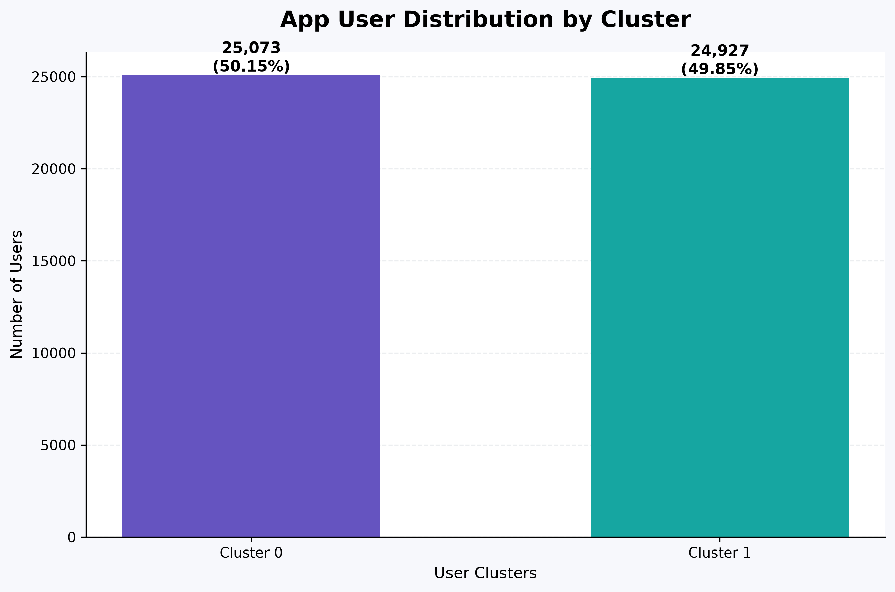
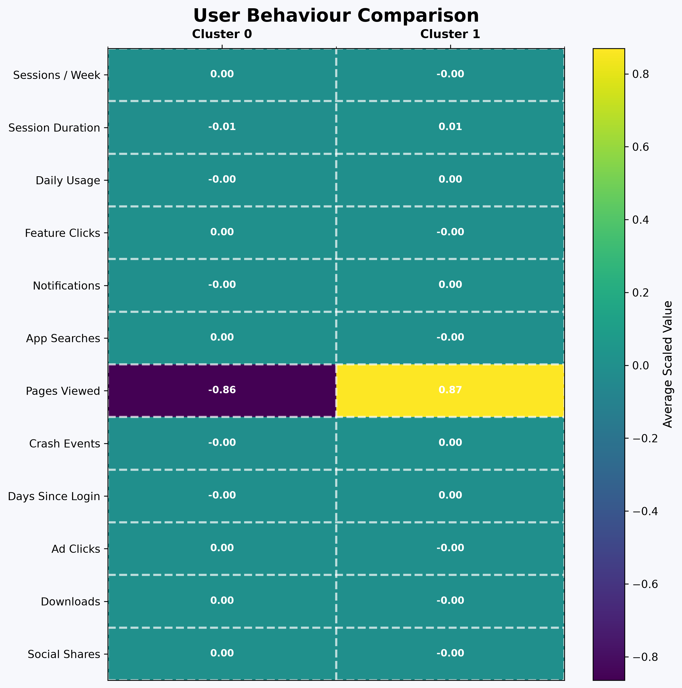
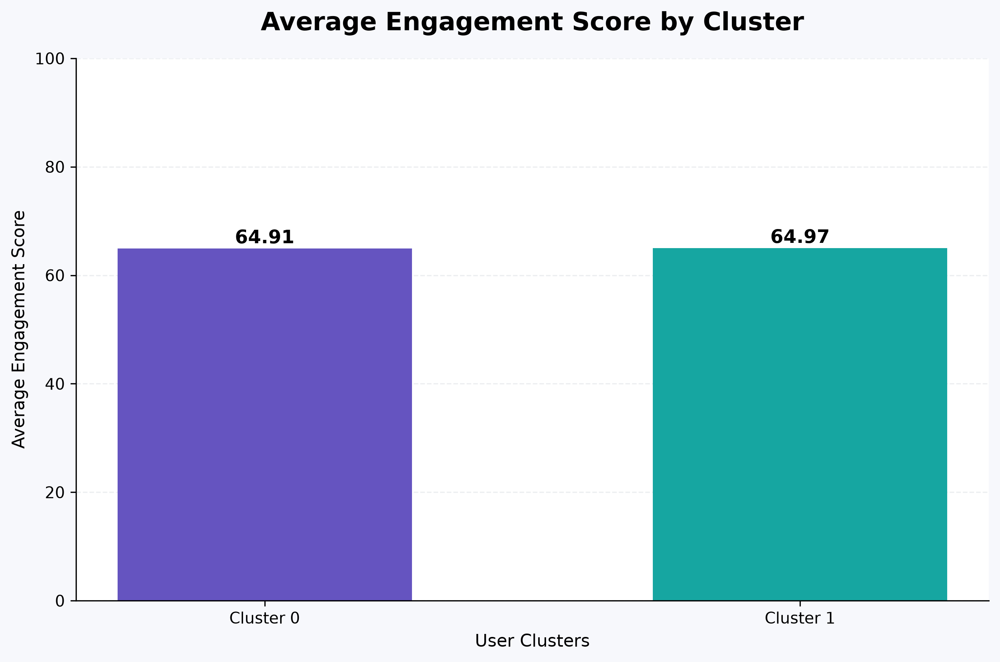

App User Behavior Segmentation Using Unsupervised Machine Learning

 1. Project Overview

This project focuses on analyzing mobile application user behavior and identifying groups of users based on their activity patterns using Unsupervised Machine Learning.

The project uses the K-Means Clustering algorithm to segment 50,000 app users based on their behavioral features.

 2. Problem Statement

Mobile applications have users with different activity patterns. Understanding these patterns helps businesses gain insights into how users interact with their applications.

The objective of this project is to identify user behavior patterns and group similar users without predefined labels.

 3. Project Objectives

- Analyze app user activity data.
- Perform data cleaning and preprocessing.
- Conduct Exploratory Data Analysis (EDA).
- Select relevant behavioral features.
- Apply K-Means clustering.
- Evaluate clustering performance.
- Visualize and interpret the results.

 4. Dataset Information

- Total Records: 50,000 users
- Total Attributes: 25
- File Format: CSV
- Machine Learning Type: Unsupervised Learning
5. Technologies Used

- Python
- Pandas
- NumPy
- Matplotlib
- Scikit-learn
- K-Means Clustering

 6. Project Workflow

1. Dataset Loading and Inspection
2. Data Cleaning and Preprocessing
3. Exploratory Data Analysis
4. Feature Selection
5. Feature Scaling using StandardScaler
6. Selecting the Optimal Number of Clusters
7. K-Means Model Implementation
8. Model Evaluation using Silhouette Score
9. Cluster Analysis and Visualization


7. Machine Learning Algorithm


K-Means Clustering

K-Means is an Unsupervised Machine Learning algorithm that groups similar data points into clusters based on their feature values.

The final model uses 12 behavioral features and creates 2 clusters.


8. Key Results

- Total Users Analyzed: 50,000
- Final Number of Clusters: 2
- Selected K: 2
- Silhouette Score: 0.0647


Cluster Distribution

| Cluster | Users | Percentage |
|---|---:|---:|
| Cluster 0 | 25,073 | 50.15% |
| Cluster 1 | 24,927 | 49.85% |

 Behavioral Findings

- Cluster 0 average pages viewed per session: 7.99
- Cluster 1 average pages viewed per session: 18.99
- Average engagement scores were nearly identical between the two clusters.

The analysis identified differences in page-view behavior. However, the low Silhouette Score indicates weak separation between the clusters.

9. Project Visualizations

 Cluster Distribution



 User Behavior Comparison




Engagement Score Comparison




10. Project Files

- `analysis.py` – Python source code
- `app_user_behavior_dataset.csv` – Original dataset
- `app_user_behavior_final_clustered.csv` – Final clustered dataset
- `final_cluster_distribution.png` – Cluster distribution chart
- `cluster_behavior_comparison.png` – Behavior comparison heatmap
- `engagement_score_comparison.png` – Engagement score comparison chart


11. How to Run the Project

Install the required libraries:

```bash
pip install pandas numpy matplotlib scikit-learn
```

Run the Python script:

```bash
python analysis.py
```

Make sure the required dataset is available in the project folder.


12. Limitations

- The Silhouette Score indicates weak cluster separation.
- Both clusters have nearly identical average engagement scores.
- The clusters should not be interpreted as high-engagement and low-engagement groups.

 13. Conclusion

This project demonstrates how Unsupervised Machine Learning can be used to analyze app user behavior and identify behavioral patterns.

Through this project, I gained practical experience in data preprocessing, Exploratory Data Analysis, feature selection, feature scaling, K-Means clustering, model evaluation, and data visualization.

---

**Developed as part of my Data Science learning journey.**
